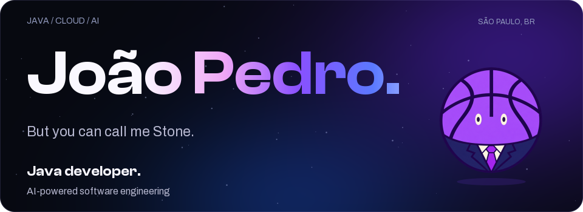
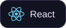
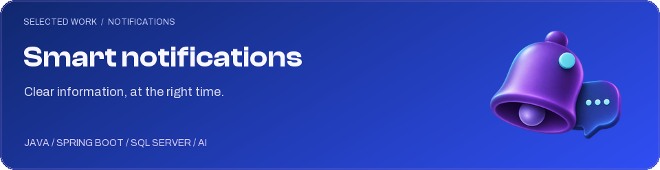
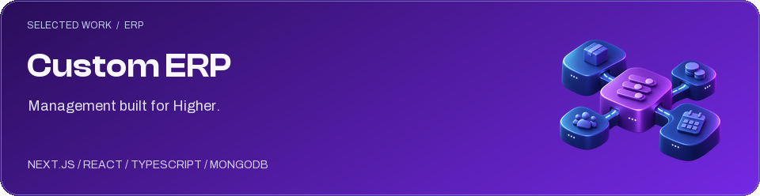
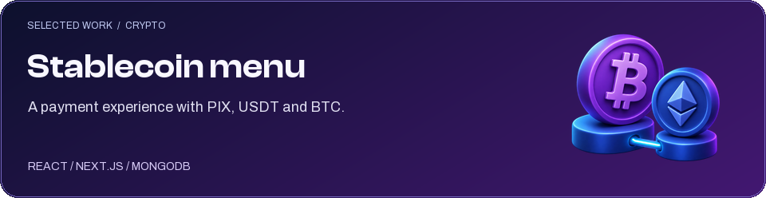

<a href="./README.pt-BR.md">Português</a>

<a href="[https://www.joaostone.com/](https://joaostone.com/)">
  <picture>
    <source media="(prefers-reduced-motion: reduce) and (max-width: 600px)" srcset="./profile-assets/hero-mobile-en-static.svg">
    <source media="(prefers-reduced-motion: reduce)" srcset="./profile-assets/hero-en-static.svg">
    <source media="(max-width: 600px)" srcset="./profile-assets/hero-mobile-en.svg">
    
  </picture>
</a>

  
  
  

### Ideas take shape. Code makes it happen.

I’m João Pedro, but you can call me **Stone**. I study Computer Science and build applications with **Java, Spring Boot and AWS**, connecting software, people and ideas.

I work on full stack development in financial and blockchain ecosystems. I care about well-designed APIs, reliable integrations and exploring how AI can help turn an idea into software.

Away from the keyboard, I’m a basketball athlete. The purple mascot brings a little of that story into my work.

### Tools I build with

  
  
  

  
  
  
  

**Also in my toolkit:** JavaScript, SQL, MongoDB, REST APIs and AI-assisted development.

### From concept to experience

[Source code](https://github.com/StoneJPPJ/app_bradesco_ia) · [Explore project](https://www.youtube.com/watch?v=NHj9VBwaEBc)

[Explore project](https://youtu.be/gUhgb0dX20k)

[Explore project](https://www.linkedin.com/feed/update/urn:li:activity:7364740664154030080/)

[Explore all projects in my portfolio →](https://www.joaostone.com/#projetos)

### Always building. Always learning.

Going deeper into Java, cloud and AI applied to software. I also share what I learn and the people I meet in the tech community.

  <a href="https://www.instagram.com/stonedeveloper/">Instagram</a> &nbsp;·&nbsp;
  <a href="https://www.linkedin.com/in/jo%C3%A3o-pedro-stone/">LinkedIn</a> &nbsp;·&nbsp;
  <a href="mailto:contatar.joao.mendes@gmail.com">Let’s talk</a>

