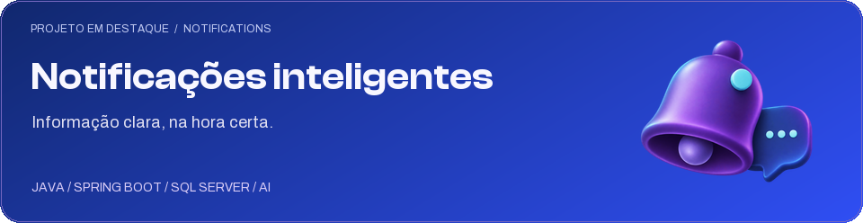
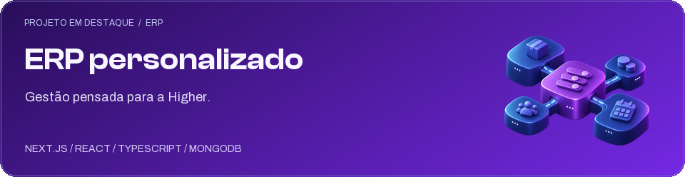
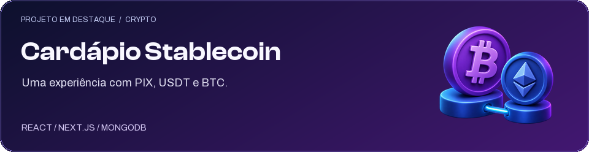

<a href="./README.md">English</a>

<a href="https://www.joaostone.com/">
  <picture>
    <source media="(prefers-reduced-motion: reduce) and (max-width: 600px)" srcset="./profile-assets/hero-mobile-pt-static.svg">
    <source media="(prefers-reduced-motion: reduce)" srcset="./profile-assets/hero-pt-static.svg">
    <source media="(max-width: 600px)" srcset="./profile-assets/hero-mobile-pt.svg">
    
  </picture>
</a>

  
  
  

### Ideias ganham forma. Código faz acontecer.

Sou João Pedro, mas pode me chamar de **Stone**. Estudo Ciência da Computação e construo aplicações com **Java, Spring Boot e AWS**, conectando software, pessoas e ideias.

Atuo com desenvolvimento full stack em contextos financeiros e blockchain. Gosto de APIs bem construídas, integrações confiáveis e de explorar como a IA pode ajudar a transformar uma ideia em software.

Fora do código, sou atleta de basquete. O mascote roxo é um pedacinho dessa história.

### Ferramentas para construir

  
  
  

  
  
  
  

**Também no meu dia a dia:** JavaScript, SQL, MongoDB, APIs REST e desenvolvimento com apoio de IA.

### Do conceito à experiência

[Código](https://github.com/StoneJPPJ/app_bradesco_ia) · [Ver projeto](https://www.youtube.com/watch?v=NHj9VBwaEBc)

[Ver projeto](https://youtu.be/gUhgb0dX20k)

[Ver projeto](https://www.linkedin.com/feed/update/urn:li:activity:7364740664154030080/)

[Ver todos os projetos no portfólio →](https://www.joaostone.com/#projetos)

### Sempre construindo. Sempre aprendendo.

Aprofundando Java, cloud e IA aplicada a software. Também compartilho aprendizados e encontros com a comunidade de tecnologia.

  <a href="https://www.instagram.com/stonedeveloper/">Instagram</a> &nbsp;·&nbsp;
  <a href="https://www.linkedin.com/in/jo%C3%A3o-pedro-stone/">LinkedIn</a> &nbsp;·&nbsp;
  <a href="mailto:contatar.joao.mendes@gmail.com">Vamos conversar</a>

